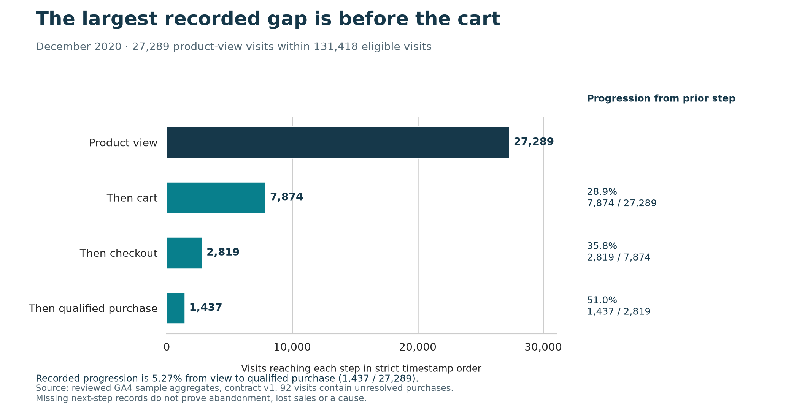

# E-commerce Funnel & Revenue Analytics

[Read the case study](https://jeks042.github.io/ecommerce-funnel-revenue.html) · [Illustrated report](reports/commercial_report.md) · [Decision memo](reports/decision_memo.md)

Where should a product team investigate the shopping journey first?

I examined how visits progressed from viewing a product to adding it to a cart, starting checkout and making a recorded purchase. The study uses Google's historical e-commerce sample, with December 2020 chosen after checking the quality of the records.

The largest recorded gap is before the cart: 7,874 of 27,289 product-view visits reached that next step. Only 1,437 completed the full observed sequence. That gives the product team a focused research question, but it does not explain why people stopped or establish how many sales could be recovered.

Mobile does not show a broad disadvantage. Its recorded progression from view to purchase is 5.41%, compared with 5.16% on desktop. Giving both groups the same daily mix leaves a small difference of 0.28 percentage points. The final checkout step points in the other direction, so a mobile-only redesign would be premature.

## What I checked before drawing a conclusion

I reviewed missing steps, repeated purchase records and uncertain identifiers, then kept events, visits, purchases and basket items at separate levels to prevent double counting. Eighteen November dates had no cart records despite checkout and purchase activity. December became the primary comparison period before examining device performance; the full November-to-January source still supports purchase qualification and coverage checks.

Unresolved purchases remain visible. Some monetary records disagree, so total revenue and average order value remain unavailable. This is historical analysis of obfuscated sample data, not a description of current shop performance.

## The recommended next step

Investigate product view to cart across devices. First verify recording and observe shopper tasks, then decide whether to test a clearer cart action. The [experiment proposal](docs/experiment_proposal.md) defines visitor assignment, seven-day outcomes and the safeguards needed before acting. It still needs a live visitor baseline, a useful improvement target and a reviewed variant.

I also explored explicit improvement assumptions. In a cohort this size, an assumed one-percentage-point cart increase means about 273 additional visits reaching the cart. Their subsequent purchasing still needs testing. The [scenario assessment](reports/opportunity_assessment.md) includes no-change and downside cases and keeps its assumptions visible. No live experiment, sales uplift or financial return has been measured.

## How the work was delivered

BigQuery SQL provides the analytical tables and checks. Python with Matplotlib and Seaborn produces four figures directly from reviewed totals, covering the journey, device comparison, recording coverage and hypothetical scenarios. The [illustrated report](reports/commercial_report.md) brings the evidence together; the [decision memo](reports/decision_memo.md) states what would justify acting.

A separate clean checkout reproduced the analysis and all eight figure files. Fresh read-only warehouse calculations reconciled all eight models and the funnel findings. The [release review](reports/milestone_6_findings.md) records the results and two small differences in approximate duration diagnostics. The full [reproduction workflow](docs/reproduction_workflow.md) explains how to repeat the work. GitHub checks validate evidence and regenerate figures without warehouse credentials or bot commits.

## Supporting evidence

- [Measurement definitions and source limits](docs/metric_contract.md)
- [Analytical tables and SQL workflow](docs/sql_workflow.md)
- [Journey findings and comparison methods](reports/milestone_3_findings.md)
- [Scenarios and experiment planning](reports/milestone_4_findings.md)
- [Source attribution and publication scope](docs/source_publication.md)
- [Reproduction and release evidence](docs/reproduction_workflow.md)
- [Completed milestones and decisions](reports/progress.md)

All six delivery stages are documented in the [GitHub milestones](https://github.com/Jeks042/ecommerce-funnel-revenue/milestones). Public artifacts contain original analysis and reviewed aggregates; source rows, identifiers, credentials and personal planning remain outside Git.

Chukwujekwu Joseph Ezema · [Portfolio](https://jeks042.github.io/) · [GitHub](https://github.com/Jeks042)
