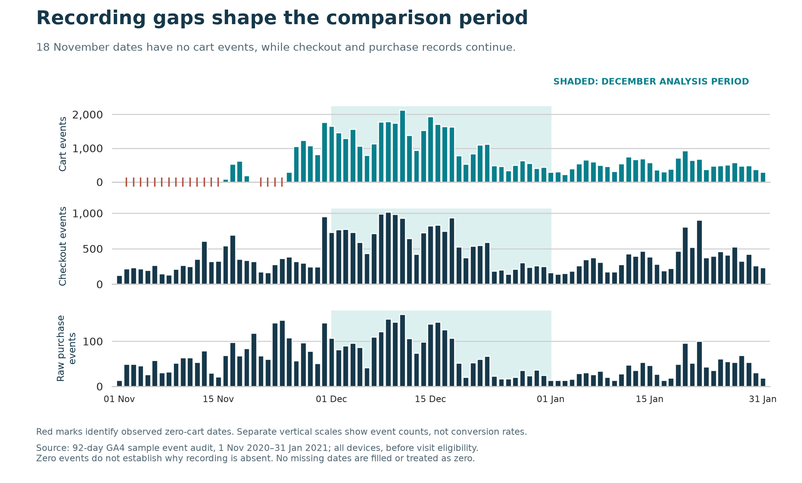
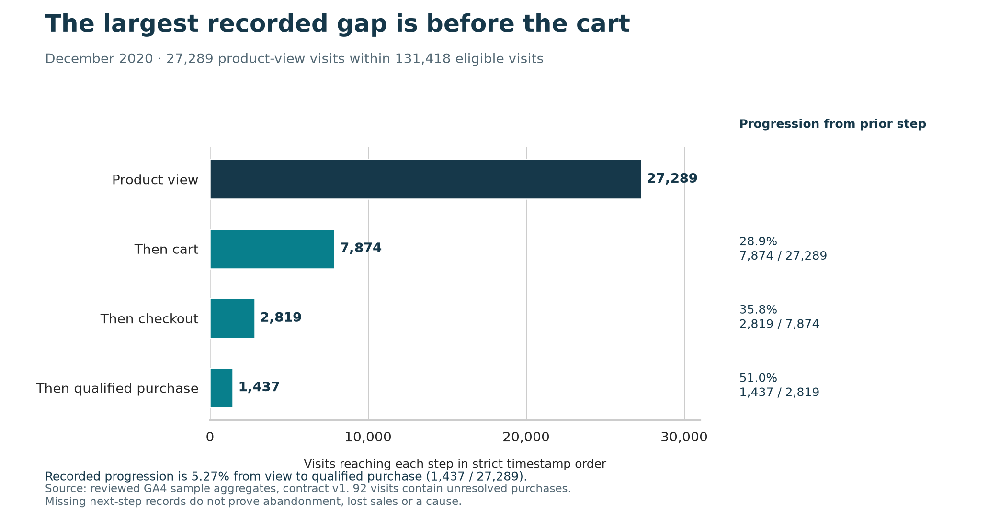
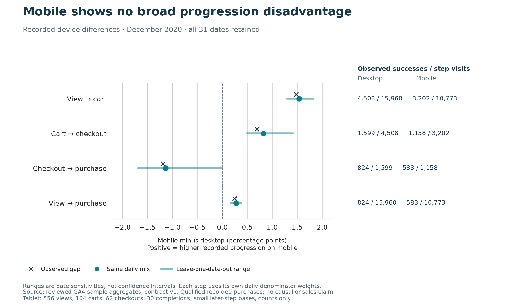
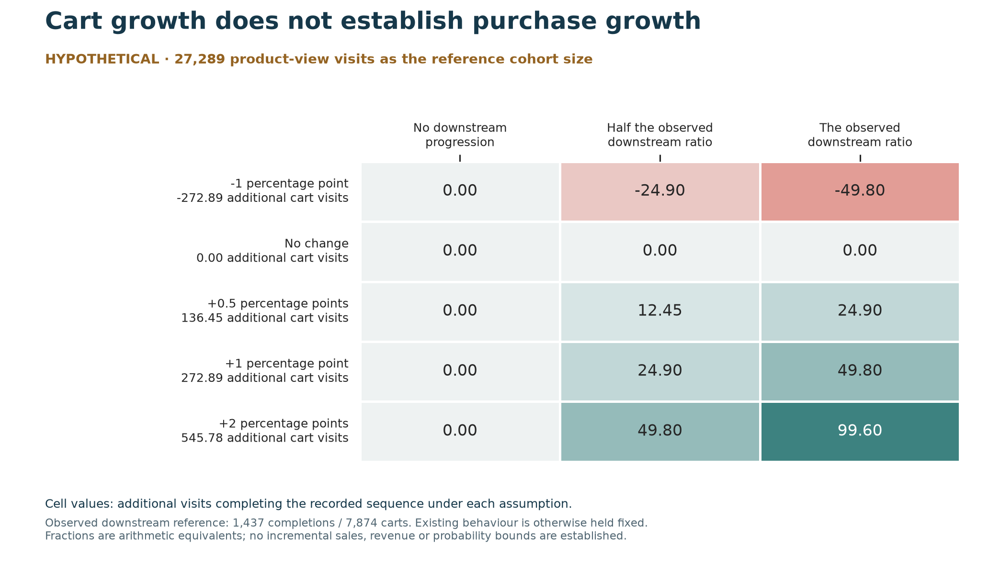

# Where to investigate the shopping journey before investing in a redesign

**Recommendation: investigate the move from product view to cart across devices. Verify the recording first, observe shopper tasks, then decide whether to test a clearer cart action.** The evidence identifies an investigation priority. It does not establish a design fault, a pool of recoverable sales or a case for a mobile-only redesign.

Prepared by **Chukwujekwu Joseph Ezema** for a product and e-commerce audience. This is an independent analysis of Google's historical, obfuscated e-commerce sample. December 2020 is the primary comparison period; November 2020–January 2021 support source checks. These records do not describe current trading performance.

The analysis followed recorded product views, carts, checkouts and purchases, checked repeated and uncertain purchase records, compared devices on common dates and explored explicit improvement assumptions. The [decision memo](decision_memo.md) gives the shorter recommendation; supporting methods and evidence are linked below.

## Why the comparison uses December

Eighteen November dates contain no cart events even though checkout and purchase records continue. Reading that pattern as shoppers abandoning their baskets would be misleading. December was chosen as a complete calendar month without those zero-cart dates, before comparing device performance. This choice narrows the analysis; it does not certify complete tracking.

The figure uses **source event counts**, before visit eligibility. Purchase events are not distinct orders. Its different panel scales help show the recording pattern, and their heights should not be read as conversion rates. The full period remains useful for checking coverage and qualifying purchase identifiers, but it is not pooled into a headline shopping funnel or used to claim a trading trend.

## Most recorded progression is lost before the cart

Of 131,418 visits meeting the agreed recording rules, 27,289 contain a product view. Within those product-view visits, 7,874 reach a later cart event, 2,819 reach later checkout and 1,437 reach a later purchase that passes the counting checks.

The largest recorded reduction is product view to cart: **19,415 visits do not reach that next step**, and 28.9% do. Progression is 35.8% from ordered cart to checkout and 51.0% from ordered checkout to a qualified recorded purchase. Overall, 5.27% of product-view visits complete the full recorded sequence.

That is a reason to examine the early journey, not evidence that all 19,415 visits represent lost customers. Browsing intent, availability, alternative paths, later returns and missing recordings could matter. The chain also measures progression within a visit; it does not require the same product at every step.

Separately, **1,976 of all 131,418 eligible visits** contain a qualified transaction, a recorded buying-visit share of 1.50%. That includes 539 buying visits without the full recorded sequence. Do not confuse buying-visit share with full-sequence progression. Ninety-two visits contain unresolved purchase records, including six that also contain qualified purchases; 70 checkout visits contain unresolved purchases. Those outcomes remain visible rather than being silently treated as known nonbuyers.

The early-step priority survives reasonable counting changes. Allowing equal timestamps gives 1,470 completions; ignoring step order gives 1,478 visits with all required event types and a qualified purchase. Allowing otherwise eligible visits to cross midnight gives 1,461 completions / 27,466 product-view visits (5.32%). These alternatives describe sensitivity, not additional sales to add to the headline count.

## The device evidence does not support a mobile-only response

Mobile's recorded view-to-purchase progression is 583 / 10,773 (5.41%), versus 824 / 15,960 (5.16%) on desktop. Giving the groups the same daily mix leaves a small mobile lead of **0.28 percentage points**, using all 31 December dates.

The pattern varies by step: mobile is ahead earlier, while checkout-to-purchase progression is slightly lower. Removing one date at a time leaves the adjusted overall difference between +0.16 and +0.37 points; the final-step difference ranges from −1.69 to −0.01 points and nearly disappears under one omission. These ranges are date sensitivities, not confidence intervals or proof of a population difference. Product mix, intent and repeat visitors remain unadjusted.

Tablet contributes 556 product views, 164 carts, 62 checkouts and 30 completions. Later-step bases are too small for the agreed comparisons, so tablet stays in the overall totals without a ranked device rate.

Acquisition context needs similar restraint. The source describes a user's original acquisition context, not the source of this visit, and 35,754 eligible visits lack an interpretable context. Differences between its larger groups do not justify advertising-budget changes or claims about channel return. The [journey findings](milestone_3_findings.md) retain those descriptive comparisons and their denominators.

## What an improvement could mean — under explicit assumptions

To give the investigation a sense of scale, use 27,289 product-view visits as a reference cohort size. Assume a change in cart progression, then vary how the additional or removed cart visits progress to a recorded completion. Keep the rest of the journey fixed. The observed downstream reference is 1,437 completions / 7,874 carts; it does not tell us how newly encouraged visitors would behave.

An assumed **one-percentage-point cart increase** produces about **273 additional cart visits** in this reference cohort. The conditional arithmetic gives zero, about 25 or about 50 additional visits completing the recorded sequence, depending on the stated downstream assumption. None of those values is a forecast of incremental purchases or revenue.

The no-change and downside rows matter as much as the positive cases. These are alternative assumptions without assigned probabilities, and the displayed values are not confidence bounds. More carts could also coexist with worse purchasing behaviour; that net harm is outside this hold-other-behaviour-fixed grid. Do not add improvements at several steps for overlapping visits. The [scenario assessment](opportunity_assessment.md) and [versioned inputs](evidence/scenario-assumptions-v1.json) explain the arithmetic.

## The decision and the evidence needed to act

| Priority | Proposed work | What it would resolve |
|---|---|---|
| First | Reconcile successful cart operations and purchase identifiers against reliable operational records. | Whether a missing next step can be interpreted consistently before testing a change. |
| Next | Review the current product page and observe representative shopper tasks on desktop and mobile. | Whether the cart-action hypothesis addresses a real obstacle rather than an assumed one. |
| If supported | Test one frozen product-page change with stable visitor assignment and seven-day outcomes. | Whether the change improves cart additions while protecting purchasing, reliability and accessibility. |
| Before broader investment | Establish incremental purchasing behaviour, contribution economics and implementation/operating cost. | Whether an observed improvement would justify a commercial rollout. |

The [experiment proposal](../docs/experiment_proposal.md) sets out a candidate change, fair assignment, outcomes and stopping rules. It counts each persistent visitor ID once across return visits. The historical visit rate must not be reused as a seven-day visitor baseline. The live baseline, meaningful business target, identity reliability, guardrail margins and calendar plan still need production evidence. No experiment has run.

Total revenue, average order value, revenue per visit, profit and advertising return remain unavailable. The source's selected item-agreeing purchase-value subset cannot stand in for complete sales or recoverable revenue. This analysis supports a focused investigation and a test proposal; it does not approve a budget or establish a financial return.

## Evidence and reproduction

The [measurement definitions](../docs/metric_contract.md), [SQL workflow](../docs/sql_workflow.md), [funnel method](../docs/funnel_analysis.md) and [report reproduction guide](../docs/report_reproduction.md) document the work. The report's four figures use reviewed aggregates only, with explicit grains, plotting data and source/code/asset hashes. A documented Python command regenerates all PNG/SVG files without warehouse credentials or notebook state.

The report and memo are complete. Final independent reproduction and the public portfolio release remain [milestone 6](https://github.com/Jeks042/ecommerce-funnel-revenue/issues/6).
