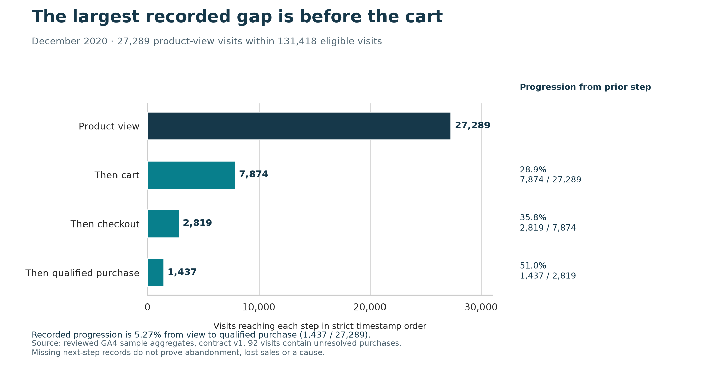
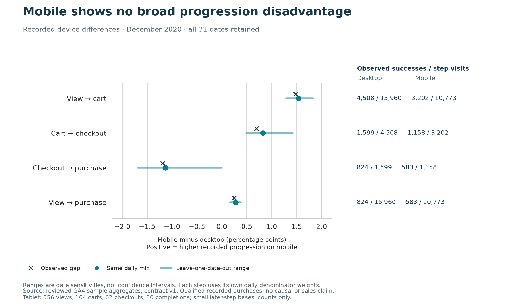

# Where the recorded shopping journey loses progression

The first place to investigate is the move from viewing a product to adding something to the cart. Of 27,289 eligible visits with a product view, 7,874 reached a later cart event. That is the largest recorded reduction, both in number of visits and as a share of the preceding step. It is a useful starting question for product research, not a count of lost customers or recoverable sales.

The device comparison gives no clear reason to make this a mobile-only investigation. Mobile records slightly higher progression from view to purchase than desktop, including after giving both groups the same daily mix. At the final checkout step, the direction reverses and the difference is small. These observations do not establish which experience is better or what a redesign would achieve.

This analysis covers **December 2020** in Google's historical, obfuscated e-commerce sample. It follows the [agreed recording and purchase rules](../docs/metric_contract.md). It does not describe current shop performance.

## The recorded journey

| Step reached in order | Visits | Progression from the preceding step |
|---|---:|---:|
| Product view | 27,289 | Entry population |
| Later cart | 7,874 | 28.9% — 7,874 / 27,289 |
| Later checkout | 2,819 | 35.8% — 2,819 / 7,874 |
| Later qualified recorded purchase | 1,437 | 51.0% — 1,437 / 2,819 |

Overall, 5.27% of product-view visits complete this recorded sequence. Separately, 1,976 of all 131,418 eligible visits contain a qualified transaction, a recorded buying-visit share of 1.50%. These answer different questions: 539 recorded buying visits do not complete the full observed sequence. Missing steps, alternative journeys and the counting rules can all matter.

There are 92 visits containing unresolved purchase records, including six that also contain qualified purchases. Seventy of the 2,819 checkout visits contain unresolved purchase records. Visits without a qualified completion must not all be described as definite abandoners. The source cannot tell us why a next step is absent, whether a shopper returned later, or whether the records captured every action.

## Device differences are modest and vary by step

Desktop and mobile are the two largest groups by product-view volume, selected before comparing rates. All 31 December dates remain in each comparison.

| Recorded progression | Desktop | Mobile | Mobile minus desktop, same daily mix |
|---|---:|---:|---:|
| View to cart | 4,508 / 15,960 — 28.25% | 3,202 / 10,773 — 29.72% | +1.54 percentage points |
| Cart to checkout | 1,599 / 4,508 — 35.47% | 1,158 / 3,202 — 36.16% | +0.82 points |
| Checkout to purchase | 824 / 1,599 — 51.53% | 583 / 1,158 — 50.35% | −1.13 points |
| View to purchase | 824 / 15,960 — 5.16% | 583 / 10,773 — 5.41% | +0.28 points |

Removing one date at a time leaves the adjusted overall gap between +0.16 and +0.37 points. The checkout gap ranges from −1.69 to −0.01 points and nearly disappears under one omission. These are checks of sensitivity to dates, not confidence intervals or proof of a population difference. Product mix, intent, repeat visitors and other differences remain unadjusted.

Tablet contributes 556 views, 164 carts, 62 checkouts and 30 completions. Its later-step bases are too small for the agreed comparison rule, so it stays in the overall counts without a ranked device rate.

## Acquisition context does not establish marketing performance

The two largest interpretable first-user contexts are `google / organic` and `(direct) / (none)`. They contain 8,418 and 6,337 product-view visits respectively. Recorded full-sequence completions are 371 / 8,418 (4.41%) and 332 / 6,337 (5.24%); giving both the same daily mix leaves a +0.81-point difference in the direct-labelled group. Both comparisons retain all 31 dates.

The apparent final-step advantage does not hold consistently: its direction changes after adjusting daily mix and when individual dates are omitted. Moreover, 35,754 eligible visits, including 7,117 product-view entries, lack an interpretable first-user context. This field describes the user's original acquisition context, not the source of this visit. It cannot justify reallocating advertising spend or claiming channel return.

## The conclusion survives reasonable counting changes

Allowing equal timestamps increases recorded completions from 1,437 to 1,470. Ignoring step order gives 1,478 visits with all required event types and a qualified transaction. The strict sequence remains the headline measure; presence alone does not establish a journey.

Allowing otherwise eligible visits to cross midnight gives 1,461 completions / 27,466 views (5.32%). Including all keyed December-start groups gives 1,475 / 27,971 (5.27%). View-to-cart remains the weakest recorded transition. Mobile's unadjusted full-sequence rate remains slightly above desktop across these population and timing alternatives; this does not establish an intervention effect.

Counting raw purchase events as completions would give 1,501 rather than 1,437. All 64 additional completion visits contain unresolved purchase IDs. Keep that recording difference visible rather than promoting it to confirmed transactions. Total revenue, average order value and any estimate of recoverable revenue remain unavailable.

## What this supports next

Start [milestone 4](https://github.com/Jeks042/ecommerce-funnel-revenue/issues/4) with a product-view-to-cart investigation across devices. Check event recording and understand shopper intent before choosing a product change. The next stage should compare explicit improvement assumptions and propose a controlled experiment, with success measures, guardrails and the evidence needed to make a commercial decision. No uplift, financial return or experiment result has been measured here.

The analysis passed 80 native-fixture aggregate checks and 4,682 source and reconciliation checks. A separate SQL calculation worked backwards from staged events and qualified purchases and matched all 93 primary device/date cells. Input counts and content checksums match the accepted tables. Python reproduces the reported comparisons and the data behind both figures. [Methods, validation and reproduction](../docs/funnel_analysis.md) provide the detail.
